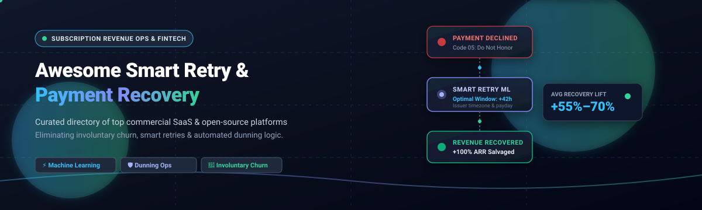

  

# Awesome Smart Retry & Payment Recovery   

> A curated collection of top **Smart Retry**, **Payment Recovery**, and **Automated Dunning** platforms. Compare enterprise SaaS solutions and open-source engines to prevent involuntary churn, optimize credit card retry logic, orchestrate multi-gateway collections, and recover failed subscription payments.

---

## 📋 Table of Contents

- [Sector Overview & Market Dynamics](#-sector-overview--market-dynamics)
- [Key Features to Look For](#-key-features-to-look-for)
- [SaaS / Hosted Platforms](#-saas--hosted-platforms)
- [Open-Source Software](#-open-source-software)
- [Comparison at a Glance](#-comparison-at-a-glance)
- [Frequently Asked Questions (FAQ)](#-frequently-asked-questions-faq)
- [Contributing](#-contributing)
- [License](#-license)

---

## 📈 Sector Overview & Market Dynamics

The subscription payment recovery and smart dunning sector addresses an estimated **$129+ billion annual loss** in involuntary churn and failed recurring payments globally, with passive declines accounting for 20% to 40% of all subscription subscriber cancellations. The market is **moderately fragmented**: core payment processors (e.g., Stripe, Adyen) provide baseline algorithmic retries in a high-concentration gateway layer, while specialized AI recovery engines, multi-gateway orchestrators, and high-touch retention services capture substantial independent market share through cross-processor intelligence and multi-channel customer dunning.

---

## 🔍 Key Features to Look For

When evaluating smart retry systems and automated payment recovery platforms, look for these architectural capabilities:

1. **Decline Code Intelligence:** Distinguishing between **hard declines** (e.g., stolen cards, closed accounts — retrying risks card scheme penalty fees) and **soft declines** (e.g., temporary bank outages, insufficient funds — safe to retry).
2. **Context-Aware ML Retry Timing:** Scheduling retry attempts based on customer time zones, issuer behavior, local payday patterns, and historical approval rate distributions rather than fixed time intervals.
3. **Automated Account Updater (AU):** Interfacing with Visa and Mastercard card account updating networks to refresh expired cards and updated tokens automatically.
4. **Branded Multi-Channel Dunning:** High-deliverability email sequences, SMS alerts, and in-app paywalls (e.g., via headless snippets) that prompt subscribers to update expired payment details.
5. **Multi-Gateway Fallback & Cascading:** Orchestrating backup merchant accounts and payment gateways when primary transactions encounter gateway outages or regional acquirer blocks.

---

## 🟦 SaaS / Hosted Platforms

Commercial, cloud-hosted Smart Retry and Payment Recovery platforms.

| Product | Pricing (Starting Tier) | Free Tier / Trial Limits | Company Size (Valuation / Revenue) | Description & Key Features | Supported Platforms |
|:---|:---|:---|:---|:---|:---|
| [Stripe Smart Retries](https://stripe.com/billing) | 0.7% per recurring transaction (Stripe Billing) | Free forever baseline: Smart Retries included with no extra monthly fee; test mode sandbox included free | $70B Valuation / ~$4.2B Net Revenue | ML-driven retry optimization timing trained on billions of transaction data points across global Stripe card traffic; automatic card account updater | Stripe ecosystem |
| [Zuora Payment Retries](https://www.zuora.com) | ~$45,000/year base contract ($3,750/mo) | No free forever tier; demo sandbox available on request for qualified prospective enterprise accounts | $1.7B Valuation (Silver Lake / GIC buyout) / ~$450M ARR | Enterprise AI-driven configurable retry engine distinguishing soft vs. hard declines; automated custom notification cadences and collections workflows | Enterprise multi-gateway |
| [Paddle Retain](https://www.paddle.com/retain) | $500/mo flat fee or performance fee (% of recovered revenue) | Free trial via live churn / recovery audit on historical data; free metrics tracking via ProfitWell Metrics | $1.4B Valuation (Series D) / ~$100M ARR | Algorithmic churn reduction and dunning engine built on billions in SaaS metrics; in-app credit card update paywalls via ProfitWell.js | Paddle, Stripe, Chargebee, Braintree |
| [Chargebee Smart Dunning](https://www.chargebee.com) | $599/mo (Performance Plan, billed annually) | Free Starter tier up to $250k lifetime billing (includes static dunning; Smart Dunning requires 14-day Performance trial or upgrade) | $3.5B Valuation (Series H) / ~$200M ARR | ML-powered dynamic retry timing adjusting attempt frequencies based on decline reasons, time zones, and bank behavior with up to 12 retries | 30+ gateways (Stripe, Braintree, Adyen) |
| [Recurly Revenue Optimization](https://recurly.com) | $249/mo + 0.9% revenue (Starter Plan; All-Access custom) | 90-day free trial on Starter plan ($40,000 billing volume allowance included during trial) | $39M+ VC Funding / ~$55M–$60M Revenue | AI propensity-to-churn models, multi-gateway failover routing, statistical machine learning retry intervals, and dynamic cancel-save workflows | Recurly gateway network |
| [Butter Payments](https://www.butterpayments.com) | Performance fee (custom revenue share of recovered revenue only; no retainer) | 30-day "First month free" trial of full recovery lift + free payment health & churn analysis audit | $100M Valuation (Series A) / ~$6M ARR ($37.5M raised) | Per-payment machine learning models tailored to card issuer behavior, subscription cadence, and geography; zero customer outreach spam | Stripe, Recharge, custom APIs |
| [Gravy Solutions](https://gravysolutions.io) | $997/mo flat fee (custom-tailored based on MRR volume) | Free 30-day failed payment recovery audit of active subscriber accounts; no software-only free tier | $4.5M Series A / ~$7.2M Revenue ($43M raised) | Human-powered recovery combining US-based customer retention agents with custom SMS, phone outreach, and 30-day personalized cadences for digital products | Stripe, Infusionsoft, Chargebee |
| [FlexPay](https://flexpay.io) | Performance fee / ROI-mapped custom fee (typically 10%–20% of recovered revenue) | Free payment decline & churn audit of historical batch records; developer sandbox credentials upon consultation | Seed/Series A / ~$6.5M–$7.2M ARR | Invisible Recovery™ using machine learning to analyze decline codes and bank algorithms for non-intrusive payment retries without client friction | 40+ gateways & CRMs |
| [Churn Buster](https://churnbuster.io) | $269/mo (Starter Dunning based on MRR tier) | Free forever "Measure" tier (baseline payment churn analytics & tracking with zero monthly subscription cost) | Bootstrapped / Profitable ($5B+ processed) | Decline-code specific retry schedules combined with high-deliverability branded dunning emails and SMS sent from custom merchant domains | 17+ platforms (Stripe, Shopify, Recharge, Braintree) |

---

## 🟩 Open-Source Software

Self-hosted, community-driven Smart Retry, Billing, and Payment Recovery tools, sorted by GitHub popularity.

### [Lago](https://github.com/getlago/lago) 
**Stack:** Ruby / Go / PostgreSQL / Redis | **License:** AGPL-3.0  
Lago is an open-source metering and billing engine built for usage-based, subscription, and hybrid pricing models. It calculates real-time customer usage fees, generates invoices, and automates collection lifecycles across Stripe, Adyen, and GoCardless. While retry execution can be delegated to connected payment gateways or orchestrators, Lago orchestrates automated overdue invoice statuses, customer notification webhooks, and grace-period management.  
**Best for:** Developers looking for modern self-hosted recurring and usage billing infrastructure with automated invoice tracking.

### [Flexprice](https://github.com/flexprice/flexprice) 
**Stack:** Go / PostgreSQL / ClickHouse | **License:** Apache-2.0  
Flexprice is an open-source, event-driven pricing, metering, and billing engine designed for AI and SaaS companies. It features modular subscription lifecycle management, payment status synchronization, and configurable invoice dunning hooks to handle failed recurring collections and payment status reconciliation across payment providers.  
**Best for:** High-volume AI and SaaS applications requiring resilient event metering paired with invoice lifecycle automation.

### [Kill Bill](https://github.com/killbill/killbill) 
**Stack:** Java / MySQL / MariaDB / PostgreSQL | **License:** Apache-2.0  
Kill Bill is an enterprise-grade open-source subscription billing and payments platform. It includes native **overdue and dunning state machines** with fully customizable retry policies (configurable payment attempt intervals, grace periods, account status changes, and cancellation cascades). Gateway plugins for Stripe, Adyen, PayPal, and Braintree provide resilient payment execution.  
**Best for:** Enterprise architectures requiring complete sovereign control over billing logic, customizable dunning state machines, and multi-gateway payment retries.

### [Laravel Cashier (Stripe)](https://github.com/laravel/cashier-stripe) 
**Stack:** PHP / Laravel | **License:** MIT  
Laravel Cashier provides an expressive interface to Stripe's subscription billing services. It natively handles webhook-driven payment failures, subscription grace periods, incomplete payment confirmations (3D Secure SCA challenges), payment method updates, and automated customer notifications when recurring subscription charges fail.  
**Best for:** Laravel and PHP developers needing battle-tested, native handling of Stripe subscription dunning and payment retry lifecycles.

### [FOSSBilling](https://github.com/FOSSBilling/FOSSBilling) 
**Stack:** PHP / MySQL | **License:** Apache-2.0  
FOSSBilling is a lightweight, open-source client management, invoicing, and recurring billing application. It features automated invoice generation, payment reminder schedules, customizable overdue suspension workflows, and payment gateway retry modules for subscription services and hosting providers.  
**Best for:** Small-to-medium digital businesses, hosting companies, and agencies wanting lightweight self-hosted dunning and recurring billing.

### [Recurso](https://github.com/recurso-dev/recurso) 
**Stack:** Go / PostgreSQL / TigerBeetle (optional) | **License:** MIT  
Recurso is an open-source billing engine featuring an innovative **multi-armed bandit retry engine for dunning** alongside a Collections operator layer. It algorithmically optimizes retry windows based on issuer feedback, includes a built-in double-entry ledger with ASC 606 revenue recognition, and integrates with Stripe, Razorpay, GoCardless, and Adyen.  
**Best for:** Teams seeking an MIT-licensed billing core with algorithmic bandit-driven payment retries built in.

---

## 📊 Comparison at a Glance

| Software | License | Stack | Smart Retry | Customer Comms | Platform Coverage | Self-Hosted | Best For |
|:---|:---|:---|:---|:---|:---|:---|:---|
| **Stripe Smart Retries** | Proprietary | Cloud | ✅ ML timing | ✅ Emails | Stripe only | ❌ | Stripe-native recovery |
| **Zuora Payment Retries** | Proprietary | Cloud | ✅ AI configurable | ✅ | Enterprise multi-gateway | ❌ | Enterprise volume |
| **Paddle Retain** | Proprietary | Cloud | ✅ Algorithmic | ✅ Branded paywalls & emails | Paddle, Stripe, Chargebee | ❌ | SaaS dunning & cancel-save |
| **Chargebee Smart Dunning** | Proprietary | Cloud | ✅ ML (Scale/Performance) | ✅ Emails | 30+ gateways | ❌ | Chargebee ecosystem |
| **Recurly** | Proprietary | Cloud | ✅ AI (All-Access) | ✅ Dynamic dunning | Multi-gateway network | ❌ | High-volume subscription brands |
| **Butter Payments** | Proprietary | Cloud | ✅ Per-payment ML | ❌ Silent recovery | Stripe, Recharge, Custom | ❌ | Pure ML recovery (zero customer spam) |
| **Gravy Solutions** | Proprietary | Cloud (Human) | ✅ Custom cadence | ✅ Human calls & SMS | Stripe, Chargebee, CRMs | ❌ | High-touch services & coaching |
| **FlexPay** | Proprietary | Cloud | ✅ Invisible Recovery™ | ✅ Engaged recovery | 40+ gateways & CRMs | ❌ | Frictionless bank-level recovery |
| **Churn Buster** | Proprietary | Cloud | ✅ Decline-code tuned | ✅ Branded email/SMS | 17+ platforms | ❌ | Branded customer recovery |
| **Lago** | AGPL-3.0 | Ruby/Go/Postgres | ⚠️ Gateway delegated | ✅ Webhooks / alerts | Stripe, Adyen, GoCardless | ✅ | Modern self-hosted usage billing |
| **Flexprice** | Apache-2.0 | Go/Postgres/ClickHouse | ⚠️ Event hooks | ✅ Dunning hooks | Multi-provider | ✅ | AI & event-metered billing |
| **Kill Bill** | Apache-2.0 | Java/DB | ✅ Configurable states | ✅ Custom templates | Via plugins (Stripe, Adyen, etc.) | ✅ | Open-source enterprise billing & dunning |
| **Laravel Cashier** | MIT | PHP | ✅ Stripe integration | ✅ Dunning webhooks & SCA | Stripe | ✅ | PHP/Laravel subscription recovery |
| **FOSSBilling** | Apache-2.0 | PHP/MySQL | ⚠️ Configurable reminders | ✅ Auto-reminders & suspend | 10+ gateways | ✅ | Lightweight billing & suspension |
| **Recurso** | MIT | Go/Postgres | ✅ Bandit engine | ⚠️ Invoicing collection | Stripe, Razorpay, Adyen | ✅ | Open-source bandit retry engine |

---

## ❓ Frequently Asked Questions (FAQ)

### What is the difference between voluntary churn and involuntary churn?
**Voluntary churn** happens when a subscriber intentionally cancels their plan (dissatisfaction, pricing, lack of use). **Involuntary churn** (passive churn) happens when a subscriber wants to stay subscribed, but their recurring payment fails due to expired payment cards, false fraud positives, daily bank limits, or temporary issuer outages.

### What is Smart Retry logic?
Unlike static retries (e.g., retrying blindly every 24 or 72 hours), **smart retry engines** employ machine learning models trained across millions of historical transactions to compute the optimal retry window. They factor in customer geography, issuer response patterns, card types, decline reason codes, and regional paydays to maximize payment settlement without incurring card network penalty flags.

### Can automated retries trigger card network fines?
Yes. Both Visa and Mastercard maintain strict limits on transaction re-attempts. Blindly hammering hard decline codes (such as stolen or closed account numbers) can lead to excessive retry fees or merchant account sanctions. Intelligent payment recovery platforms automatically suppress retries on unrecoverable decline codes.

---

## 🤝 Contributing

Contributions are welcome! If you know of an open-source Smart Retry or Payment Recovery tool that should be listed here, please open a pull request with:

- Project name and URL
- Brief description (1–2 sentences)
- Stack and license
- Why it stands out

Please ensure the project is actively maintained (releases within the last 12 months) and genuinely open-source. Note that the open-source ecosystem for **dedicated payment recovery** is essentially nonexistent — payment recovery is dominated by specialized commercial services that combine ML-driven retry timing, branded customer communication, and human tuning. **Recurso** is the most notable open-source option, offering a bandit-retry dunning engine within a broader MIT-licensed billing platform [citation:11]. **Churn Buster** and **Butter Payments** represent the commercial gold standard for multi-platform recovery with ML optimization and human oversight [citation:4][citation:7]. For teams already on Stripe, **Stripe Smart Retries** provides ML-driven recovery without additional tooling, though it cannot match the multi-platform coverage or human tuning of dedicated services [citation:2].

---

## 📄 License

This list is released under CC0 1.0 Universal (Public Domain). The software projects listed retain their respective licenses.

---

⭐ **If this list helped you discover a useful tool, please star the repo!** ⭐
